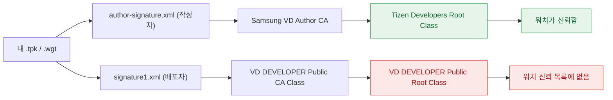

# 타이젠 갤럭시워치에 직접 만든 워치페이스가 더 이상 설치되지 않는 이유 (2026)

[](#테스트-환경)
[](#테스트-환경)
[](#테스트-환경)
[](#요약)
[](LICENSE)

[English](README.md) · **한국어**

**Galaxy Watch Studio / Galaxy Watch Designer**(또는 Tizen Studio)로 만든 워치페이스를 **타이젠 갤럭시워치**(갤럭시워치, 워치3, 액티브, 액티브2, 기어 S3, 기어 스포츠)에 설치할 수 없는 이유를, 직접 재현할 수 있는 형태로 정리한 기록이에요. 삼성 인증서 발급에 성공해도 설치는 막혀요.

## 요약

- 삼성 인증서 서버는 이제 **`VD DEVELOPER Public Root Class`에 연결된 배포자(distributor) 인증서**를 발급해요.
- 그런데 이 루트가 **워치의 신뢰 목록에 없어서**, 새로 발급받은 인증서로 서명한 패키지는 전부 거부돼요.
  `Check certificate error [-12]` · `Non trusted certificate is used. Register valid certificate:<-32>`
- 인증서 관리자의 `Key store type should be PKCS12` 오류를 고치면 인증서 **발급**까지만 돼요. 워치가 받아들이게 되지는 않아요.
- Tizen Studio 기본 인증서는 워치에서 **폐기(revoked)** 목록에 있어서 이것도 안 돼요.
- 워치는 더 이상 펌웨어 업데이트가 없고 신뢰 목록은 읽기 전용이라, **사용자 쪽에서 고칠 방법이 없어요.**
- 지금도 되는 것: 기본 **My Photo+** 페이스(내 이미지를 배경으로, 시계는 디지털만).

> 아래 모델과 펌웨어 하나로 검증했어요. 다른 타이젠 5.5 워치도 같은 이유로 막힐 가능성이 높아요. [기기별 결과 제보](#기기별-결과-제보)를 환영해요.

## 목차

- [증상](#증상)
- [원인](#원인)
- [근거](#근거)
- [내 워치에서 직접 확인하기](#내-워치에서-직접-확인하기)
- [시도한 방법](#시도한-방법)
- [지금 할 수 있는 것](#지금-할-수-있는-것)
- [자주 묻는 질문](#자주-묻는-질문)
- [기기별 결과 제보](#기기별-결과-제보)
- [참고 자료](#참고-자료)

## 증상

| 위치 | 메시지 | 이번 테스트 |
| --- | --- | --- |
| `sdb install` / Run on Device | `Check certificate error [-12] failed` | 재현됨 |
| `sdb install` / Run on Device | `Non trusted certificate is used. Register valid certificate:<-32>` | 재현됨 |
| 인증서 관리자, 삼성 로그인 후 | `Key store type should be PKCS12 or any other valid entry.` | 보고됨. 우리 파일 상태와도 일치 (작성자 `.crt`는 발급, `.p12`는 없음) |
| 인증서 관리자 | 장치 종류에 **TV**만 보임 | 확장 2.0.75에서 보고됨 |
| Galaxy Watch Studio | 배포자 인증서 요청이 반응 없음 / 로그인 실패 | 널리 보고됨 |

## 원인

타이젠 워치는 패키지의 서명 **두 개가 모두** 워치가 신뢰하는 루트에 연결될 때만 설치해요.



| 서명 | 인증서 체인 | 워치 판정 |
| --- | --- | --- |
| 작성자, 삼성 인증서 (2026년 11월 발급) | `Samsung VD Author CA` → `Tizen Developers Root Class` | 신뢰 |
| 작성자, Tizen Studio 기본 | `Tizen Developers CA` → `Tizen Developers Root` | **폐기됨** |
| 배포자, 삼성 인증서 (2026년 11월 발급) | `VD DEVELOPER Public CA Class` → `VD DEVELOPER Public Root Class` | **목록에 없음** |
| 배포자, Tizen Studio 기본 | `Tizen Public Distributor CA` → `Tizen Public Distributor Root CA` | **폐기됨** |

작성자 쪽은 삼성 작성자 인증서를 쓰면 해결돼요. 배포자 쪽은 해결할 수 없어요. 삼성이 이제 VD(Visual Display, TV 사업부) 계열로만 발급하는데, 워치 펌웨어는 원래부터 이 계열을 신뢰하지 않았어요.

## 근거

### 설치 시도

```text
$ sdb install PowerClock.tpk
...
key[error] val[-12] error message: :Non trusted certificate is used. Register valid certificate:<-32>
processing result : Check certificate error [-12] failed
```

마운트 설치(`sdb shell pkgcmd -w -t tpk -p <경로>`)도 같은 오류로 실패해요.

### 워치의 신뢰 목록

워치는 `/usr/share/ca-certificates/fingerprint/fingerprint_list.xml`과 `fingerprint_list_ext.xml`로 어떤 루트를 믿을지 정하고, 루트 인증서 파일은 `/usr/share/ca-certificates/tizen/`에 있어요.

**공개(public)** 등급 배포자로 신뢰하는 루트:

- `GEAR2 PROD Public Root Class`, `GEAR2 DEVELOPER Public Root Class`, `GEAR2 Test Public Root Class`
- `Samsung Tizen DEVELOPER Public Root Class`, `Samsung Tizen Public Root Class`
- `Tizen Store Public Root Class`, `Tizen Store TEST Public Root Class`
- `Tizen Association DEVELOPER Public Root Class`

**`VD DEVELOPER Public Root Class`는 지문 목록에도, 인증서 폴더에도 없어요.** 폐기된 루트를 포함한 전체 목록은 [docs/watch-trust-list.md](docs/watch-trust-list.md)에 있어요.

### 인증서 확장도 VD로 바뀜

Samsung Certificate Extension 2.0.74(`org.tizen.common.cert_1.0.0.202509220200.jar`, `res/ca/`) 안에서, 모바일/웨어러블용 이름을 유지한 배포자 CA 파일(`samsung_tizen_dev_public2.crt`, `gear_test_public_CA.cer`)의 내용이 이미 `VD DEVELOPER Public CA Class`예요. 2.0.75에서는 모바일/웨어러블 장치 종류가 아예 사라졌다는 사용자 보고가 있어요.

### 2026년 PKCS#12 가이드와의 관계

2026년 11월에 올라온 가이드들은 확장 프로그램 안의 작성자 CA 파일을 바꿔 `Key store type should be PKCS12` 오류를 고쳐요. 작성자 인증서를 **발급**받는 데는 맞는 진단이에요. 하지만 설치 여부는 워치가 정하고, 워치에는 여전히 배포자 루트가 없어요. 설치 성공을 보여주지 않고 "된다"고 하는 가이드는 주의하세요.

## 내 워치에서 직접 확인하기

[`tools/check_signature_trust.py`](tools/check_signature_trust.py)는 패키지의 서명을 워치의 신뢰 목록과 비교해서, 몇 시간을 쓰기 전에 설치 가능 여부를 알려줘요.

```bash
# 워치에서 디버깅을 켜고 PC와 같은 Wi-Fi에 연결
sdb connect <watch-ip>:26101
sdb pull /usr/share/ca-certificates ./watch-ca

pip install cryptography
python3 tools/check_signature_trust.py MyFace.tpk --watch-ca ./watch-ca
```

2026년 11월에 발급받은 인증서로 서명한 패키지의 결과 예시:

```text
author-signature.xml
  chain : Samsung VD Author CA -> Tizen Developers Root Class
  root  : Tizen Developers Root Class  [Tizen_Developers_Root_Class.pem]  domains: tizen-developer
  result: trusted root

signature1.xml
  chain : VD DEVELOPER Public CA Class -> VD DEVELOPER Public Root Class
  root  : VD DEVELOPER Public Root Class
  result: NOT IN WATCH TRUST STORE  (install will fail: -12 / <-32>)

OVERALL: at least one signature will be rejected by this watch
```

루트를 신뢰한다고 꼭 설치되는 건 아니에요. 개발자용 루트는 배포자 인증서에 내 워치의 기기 ID도 들어 있어야 해요.

## 시도한 방법

| 방법 | 결과 | 이유 |
| --- | --- | --- |
| 인증서 관리자 + 확장 2.0.74 | 인증서 발급됨 | 배포자 루트를 워치가 신뢰하지 않음 |
| 마운트 설치 (`pkgcmd -w`) | 실패 | 같은 인증서 검사 |
| "인증서 없이 설치" 도구 (XDA의 TizenInstaller 등) | 해당 없음 | 도구 설명에도 직접 만든 Galaxy Watch Studio 페이스는 안 된다고 명시 |
| WatchMaker (스토어 종료 전에 앱을 설치해 둔 경우) | 진행 안 함 | 내 이미지 사용은 유료 프리미엄. 현재 폰 앱의 타이젠 지원도 불확실 |
| Facer + 안드로이드 폰 | 실패 | 안드로이드용 워치 앱이 필요한데, 스토어 종료로 새로 설치할 수 없음 |
| Facer + 아이폰 (스토어 종료 전에 앱을 설치해 둔 경우) | 실패 | Facer 화면 4번 탭 → QR로 연결까지는 됨. 하지만 보낸 페이스가 도착하지 않았고, 3번 탭 메뉴의 CURRENT 칸도 바뀌지 않음 |
| **My Photo+** (기본) | **됨** | 배경 이미지만, 시계는 디지털만 |

> 스토어 종료 뒤 비공식 경로로 구한 앱 패키지를 설치하는 건 저작권과 보안 문제가 있을 수 있어서 권장하지 않아요.

## 지금 할 수 있는 것

**My Photo+ (기본 페이스)**

1. 다이얼을 360 × 360 이미지로 저장해요. 날짜 창처럼 정지 이미지로는 동작하지 않는 요소는 지우고, 디지털 시계가 들어갈 자리를 비워 두세요.
2. Galaxy Wearable → 워치 화면 → My Photo+ → 꾸미기 → 사진 추가.
3. 폰 연결이 안 되면, 디버깅을 켠 상태에서 이미지를 워치 갤러리로 바로 넣을 수 있어요.

```bash
sdb push dial.png /opt/usr/home/owner/media/Images/
sdb shell mediadb-update -r /opt/usr/home/owner/media/Images
```

**갤럭시워치4 이후 (Wear OS)**

Watch Face Studio로 만든 페이스를 Wi-Fi 디버깅으로 바로 설치할 수 있어요. 삼성 인증서 서버가 필요 없어요.

## 자주 묻는 질문

<details>
<summary><b>PKCS#12 오류를 고치고 인증서도 받았는데 왜 설치가 안 되나요?</b></summary>

PKCS#12 수정은 인증서 관리자가 PC에 작성자 인증서를 저장하는 방식만 고쳐요. 워치는 배포자 인증서의 루트를 확인하는데, 지금 루트(`VD DEVELOPER Public Root Class`)가 신뢰 목록에 없어요.
</details>

<details>
<summary><b>예전에 받은 삼성 배포자 인증서는 아직 되나요?</b></summary>

여기서는 확인하지 못했어요. 전환 전에 발급돼 `Samsung Tizen DEVELOPER Public Root Class`나 `GEAR2 DEVELOPER Public Root Class`에 연결되고 아직 유효한 인증서라면, 워치의 신뢰 목록과는 맞아요. 그 인증서로 서명한 패키지를 검사 도구로 확인해 보세요.
</details>

<details>
<summary><b>빠진 루트를 워치에 추가할 수 없나요?</b></summary>

없어요. 신뢰 목록은 읽기 전용 시스템 폴더에 있고, 일반 판매 워치는 루트 권한이 없으며, 타이젠 워치는 더 이상 펌웨어 업데이트가 없어요.
</details>

<details>
<summary><b>삼성이 고쳐줄까요?</b></summary>

가능성이 낮아요. 삼성 개발자 포럼에서 삼성 측은 타이젠 워치 앱 배포가 이미 끝났으니 삼성 인증서 생성 기능도 곧 없앨 예정이라고 답했어요.
</details>

<details>
<summary><b>페어링이나 인증서 문제를 해결하려고 워치를 초기화해도 되나요?</b></summary>

하지 마세요. 2025년 9월 30일부터 갤럭시 스토어가 타이젠 워치 콘텐츠를 제공하지 않아서, 초기화로 지워진 앱은 다시 받을 수 없어요. 폰과의 페어링은 블루투스로 하고, 같은 Wi-Fi인지는 상관없어요. Wi-Fi 디버깅 때문에 워치 블루투스를 꺼뒀다면 다시 켜세요.
</details>

## 테스트 환경

| 항목 | 값 |
| --- | --- |
| 워치 | Galaxy Watch (2018) SM-R805N |
| 워치 OS | Tizen `wearable-5.5.0.2` (One UI Watch 2.0, 최종 펌웨어) |
| PC | Windows, Tizen Studio (SDK 10.0) |
| 인증서 확장 | Samsung Certificate Extension 2.0.74 |
| 워치페이스 도구 | Galaxy Watch Designer 1.8.1 |
| 검증일 | 2026-11-22 |

## 기기별 결과 제보

다른 타이젠 워치를 갖고 있다면 검사 도구를 실행해 보고 [이슈로 제보](https://github.com/DevAaronJeong/galaxy-watch-tizen-watchface-2026/issues/new?title=%5BDevice%20report%5D%20)해 주세요. 아래 내용을 넣어 주시면 돼요.

- 워치 모델과 타이젠 버전 (디바이스 매니저에 표시, 예: `wearable-5.5.0.2`)
- Samsung Certificate Extension 버전
- `tools/check_signature_trust.py` 실행 결과 전체
- 설치 결과와 정확한 오류 메시지

기기 ID(DUID), 이메일, IP 같은 개인정보는 지우고 올려 주세요. 갤럭시워치3, 워치 액티브2, 기어 S3, 기어 스포츠 결과와 설치 성공 사례가 특히 도움이 돼요.

## 참고 자료

- [Solution for PKCS#12 error for creating certificates on a Tizen Watch3](https://forum.developer.samsung.com/t/solution-for-pkcs-12-error-for-creating-cetificates-on-a-tizen-watch3/42338), 삼성 개발자 포럼: 인증서 생성 오류와, 기능을 없앨 예정이라는 삼성 측 답변
- [Samsung Certificate Manager Update](https://forum.developer.samsung.com/t/samsung-certificate-manager-update/42367), 삼성 개발자 포럼: 발급 서버 교체, 2.0.74 이상으로 업데이트 안내
- [Samsung will stop offering content to Tizen smartwatches](https://www.androidauthority.com/samsung-tizen-os-support-ending-3592909/), Android Authority: 2025년 9월 30일 타이젠 워치 콘텐츠 다운로드 종료
- [tizen-watchface-starter](https://github.com/MatrixZockt/tizen-watchface-starter): PKCS#12 작성자 CA 불일치 분석. 이 레포는 그다음 설치 단계를 다뤄요.

## 라이선스

문서: [CC BY 4.0](LICENSE). `tools/`: MIT (파일 머리말 참고).

삼성과 관련이 없어요. 제품 이름은 각 소유자의 상표예요.
