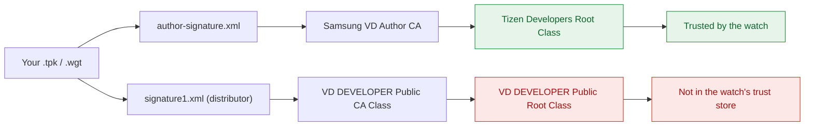

# Custom Watch Faces on Tizen Galaxy Watches: Why They No Longer Install (2026)

[](#test-environment)
[](#test-environment)
[](#test-environment)
[](#tldr)
[](LICENSE)

**English** · [한국어](README.ko.md)

A reproducible investigation into why watch faces built with **Galaxy Watch Studio / Galaxy Watch Designer** (or Tizen Studio) can no longer be sideloaded onto **Tizen-based Galaxy Watches** (Galaxy Watch, Watch3, Active, Active2, Gear S3, Gear Sport), even after the Samsung certificate is issued successfully.

## TL;DR

- Samsung's certificate service now issues **distributor certificates chained to `VD DEVELOPER Public Root Class`**.
- That root is **not in the watch's trust store**, so every package signed with a newly issued certificate is rejected:
  `Check certificate error [-12]` · `Non trusted certificate is used. Register valid certificate:<-32>`
- Fixing the well-known `Key store type should be PKCS12` error in Certificate Manager only gets the certificate **issued**. It does not make the watch accept it.
- Tizen Studio's default certificates are on the watch's **revoked** list, so they do not work either.
- The watch receives no more firmware updates and its trust store is read-only, so **there is no user-side fix**.
- What still works: the built-in **My Photo+** face (your image as the background, digital clock only).

> Tested on one model and firmware (below). Other Tizen 5.5 watches are very likely affected the same way. [Device reports](#help-wanted-device-reports) are welcome.

## Contents

- [Symptoms](#symptoms)
- [Root cause](#root-cause)
- [Evidence](#evidence)
- [Check your own watch](#check-your-own-watch)
- [What we tried](#what-we-tried)
- [What still works](#what-still-works)
- [FAQ](#faq)
- [Help wanted: device reports](#help-wanted-device-reports)
- [References](#references)

## Symptoms

You are probably here because of one of these:

| Where | Message | In this test |
| --- | --- | --- |
| `sdb install` / Run on Device | `Check certificate error [-12] failed` | Reproduced |
| `sdb install` / Run on Device | `Non trusted certificate is used. Register valid certificate:<-32>` | Reproduced |
| Certificate Manager, after Samsung login | `Key store type should be PKCS12 or any other valid entry.` | Reported; consistent with our files (author `.crt` issued, no `.p12`) |
| Certificate Manager | Device Type page shows **TV** only | Reported for extension 2.0.75 |
| Galaxy Watch Studio | Distributor certificate request does nothing / sign-in fails | Widely reported |

## Root cause

A Tizen watch installs a package only if **both** of its signatures chain to roots that the watch trusts:



| Signature | Certificate chain | Watch verdict |
| --- | --- | --- |
| Author, Samsung certificate (issued Nov 2026) | `Samsung VD Author CA` → `Tizen Developers Root Class` | Trusted |
| Author, Tizen Studio default | `Tizen Developers CA` → `Tizen Developers Root` | **Revoked** |
| Distributor, Samsung certificate (issued Nov 2026) | `VD DEVELOPER Public CA Class` → `VD DEVELOPER Public Root Class` | **Not present** |
| Distributor, Tizen Studio default | `Tizen Public Distributor CA` → `Tizen Public Distributor Root CA` | **Revoked** |

The author side can be fixed by using a Samsung author certificate. The distributor side cannot: Samsung now issues it only from the VD ("Visual Display", the TV business) hierarchy, which the watch firmware never trusted.

## Evidence

### Install attempt

```text
$ sdb install PowerClock.tpk
...
key[error] val[-12] error message: :Non trusted certificate is used. Register valid certificate:<-32>
processing result : Check certificate error [-12] failed
```

Mount install (`sdb shell pkgcmd -w -t tpk -p <path>`) fails with the same error.

### The watch's trust store

The watch decides which roots to trust from
`/usr/share/ca-certificates/fingerprint/fingerprint_list.xml` and `fingerprint_list_ext.xml`, with the root certificates in `/usr/share/ca-certificates/tizen/`.

Distributor roots trusted at the **public** level:

- `GEAR2 PROD Public Root Class`, `GEAR2 DEVELOPER Public Root Class`, `GEAR2 Test Public Root Class`
- `Samsung Tizen DEVELOPER Public Root Class`, `Samsung Tizen Public Root Class`
- `Tizen Store Public Root Class`, `Tizen Store TEST Public Root Class`
- `Tizen Association DEVELOPER Public Root Class`

**`VD DEVELOPER Public Root Class` appears in neither the fingerprint lists nor the certificate folder.** The full list, including the revoked roots, is in [docs/watch-trust-list.md](docs/watch-trust-list.md).

### The certificate extension switched to VD as well

Inside Samsung Certificate Extension 2.0.74 (`org.tizen.common.cert_1.0.0.202509220200.jar`, `res/ca/`), the distributor CA files that keep their mobile/wearable names (`samsung_tizen_dev_public2.crt`, `gear_test_public_CA.cer`) already contain `VD DEVELOPER Public CA Class`. Users report that version 2.0.75 removes the Mobile/Wearable device type entirely.

### How this relates to the 2026 PKCS#12 guides

Guides published in November 2026 fix the `Key store type should be PKCS12` error by replacing the author CA file inside the extension. That diagnosis is correct for **issuing** the author certificate. But installation is decided on the watch, and the distributor root is still missing there. If a guide says the method "works" without showing a successful install, treat it with caution.

## Check your own watch

[`tools/check_signature_trust.py`](tools/check_signature_trust.py) compares the signatures in a package with your watch's trust store and tells you before you spend hours on it.

```bash
# Enable debugging on the watch and join the same Wi-Fi as your computer
sdb connect <watch-ip>:26101
sdb pull /usr/share/ca-certificates ./watch-ca

pip install cryptography
python3 tools/check_signature_trust.py MyFace.tpk --watch-ca ./watch-ca
```

Example output for a package signed with a certificate issued in November 2026:

```text
author-signature.xml
  chain : Samsung VD Author CA -> Tizen Developers Root Class
  root  : Tizen Developers Root Class  [Tizen_Developers_Root_Class.pem]  domains: tizen-developer
  result: trusted root

signature1.xml
  chain : VD DEVELOPER Public CA Class -> VD DEVELOPER Public Root Class
  root  : VD DEVELOPER Public Root Class
  result: NOT IN WATCH TRUST STORE  (install will fail: -12 / <-32>)

OVERALL: at least one signature will be rejected by this watch
```

A trusted root is necessary but not sufficient: developer roots also require your watch's device ID in the distributor certificate.

## What we tried

| Approach | Result | Why |
| --- | --- | --- |
| Certificate Manager + extension 2.0.74 | Certificate issued | Distributor root not trusted by the watch |
| Mount install (`pkgcmd -w`) | Failed | Same certificate check |
| "Install without certificates" tools (e.g. TizenInstaller on XDA) | Not applicable | Their own documentation says self-made Galaxy Watch Studio faces do not work |
| WatchMaker (app already installed before the store closed) | Not pursued | Using your own images requires the paid premium tier; current phone-app support for Tizen is unclear |
| Facer with an Android phone | Failed | Needs the Android build of the watch app, which can no longer be installed after the store shutdown |
| Facer with an iPhone (app already installed before the store closed) | Failed | Pairing by QR code works (tap the Facer face four times), but synced faces never arrived and the CURRENT slot in the triple-tap menu did not update |
| **My Photo+** (built-in) | **Works** | Background image only, digital clock only |

> Installing app packages obtained from unofficial sources after the store shutdown may raise copyright and security issues and is not recommended.

## What still works

**My Photo+ (built-in face)**

1. Export your dial as a 360 × 360 image. Remove elements that cannot work in a still image (for example a date window) and leave room for the digital clock.
2. Galaxy Wearable → Watch faces → My Photo+ → Customize → Add photo.
3. No phone connection? With debugging on, copy the image straight into the watch's gallery:

```bash
sdb push dial.png /opt/usr/home/owner/media/Images/
sdb shell mediadb-update -r /opt/usr/home/owner/media/Images
```

**Galaxy Watch4 or later (Wear OS)**

Faces made in Watch Face Studio install directly over Wi-Fi debugging. No Samsung certificate service is involved.

## FAQ

<details>
<summary><b>I fixed the PKCS#12 error and got my certificates. Why does install still fail?</b></summary>

The PKCS#12 fix only affects how Certificate Manager stores the author certificate on your computer. The watch checks the distributor certificate's root, and the current root (`VD DEVELOPER Public Root Class`) is not in its trust store.
</details>

<details>
<summary><b>Will an old Samsung distributor certificate still work?</b></summary>

Untested here. A certificate issued before the switch, chained to `Samsung Tizen DEVELOPER Public Root Class` or `GEAR2 DEVELOPER Public Root Class` and still valid, matches the watch's trust store. Run the checker on a package signed with it to confirm.
</details>

<details>
<summary><b>Can I add the missing root to my watch?</b></summary>

No. The trust store lives in read-only system directories, retail watches have no root access, and Tizen watches no longer receive firmware updates.
</details>

<details>
<summary><b>Will Samsung fix this?</b></summary>

Unlikely. In the Samsung Developer Forums, Samsung staff stated that since distribution of Tizen watch apps has stopped, the Samsung certificate creation feature would be deprecated and removed.
</details>

<details>
<summary><b>Should I factory-reset the watch to fix pairing or certificate problems?</b></summary>

Do not. Since 30 September 2025 the Galaxy Store no longer delivers Tizen watch content, so apps removed by a reset cannot be downloaded again. Pairing with the phone uses Bluetooth; being on the same Wi-Fi does not matter. If you disabled the watch's Bluetooth for Wi-Fi debugging, turn it back on.
</details>

## Test environment

| Item | Value |
| --- | --- |
| Watch | Galaxy Watch (2018) SM-R805N |
| Watch OS | Tizen `wearable-5.5.0.2` (One UI Watch 2.0, final firmware) |
| Host | Windows, Tizen Studio (SDK 10.0) |
| Certificate extension | Samsung Certificate Extension 2.0.74 |
| Face tool | Galaxy Watch Designer 1.8.1 |
| Date | 2026-11-22 |

## Help wanted: device reports

If you own another Tizen watch, please run the checker and [open an issue](https://github.com/DevAaronJeong/galaxy-watch-tizen-watchface-2026/issues/new?title=%5BDevice%20report%5D%20) with:

- Watch model and Tizen version (Device Manager shows it, e.g. `wearable-5.5.0.2`)
- Samsung Certificate Extension version
- Full output of `tools/check_signature_trust.py`
- Install result and the exact error message

Remove personal data first: device ID (DUID), e-mail addresses, IP addresses. Reports from Galaxy Watch3, Watch Active2, Gear S3 and Gear Sport are especially useful, as are any successful installs.

## References

- [Solution for PKCS#12 error for creating certificates on a Tizen Watch3](https://forum.developer.samsung.com/t/solution-for-pkcs-12-error-for-creating-cetificates-on-a-tizen-watch3/42338), Samsung Developer Forums: the certificate creation errors, and Samsung's statement that the feature will be deprecated
- [Samsung Certificate Manager Update](https://forum.developer.samsung.com/t/samsung-certificate-manager-update/42367), Samsung Developer Forums: the issuing server was replaced; update to 2.0.74 or later
- [Samsung will stop offering content to Tizen smartwatches](https://www.androidauthority.com/samsung-tizen-os-support-ending-3592909/), Android Authority: Galaxy Store downloads for Tizen watches end on 30 September 2025
- [tizen-watchface-starter](https://github.com/MatrixZockt/tizen-watchface-starter): analysis of the PKCS#12 author-CA mismatch; this repository covers what happens at install time

## License

Documentation: [CC BY 4.0](LICENSE). `tools/`: MIT (see the file header).

Not affiliated with Samsung. Product names are trademarks of their respective owners.
